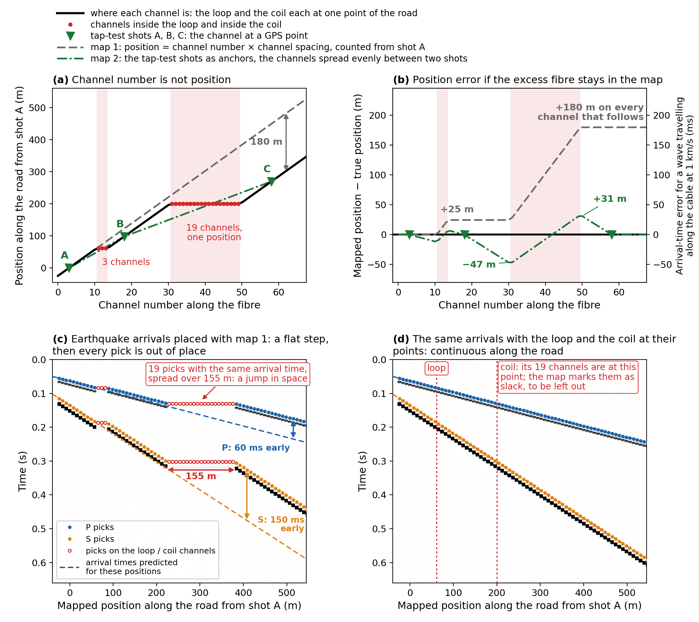
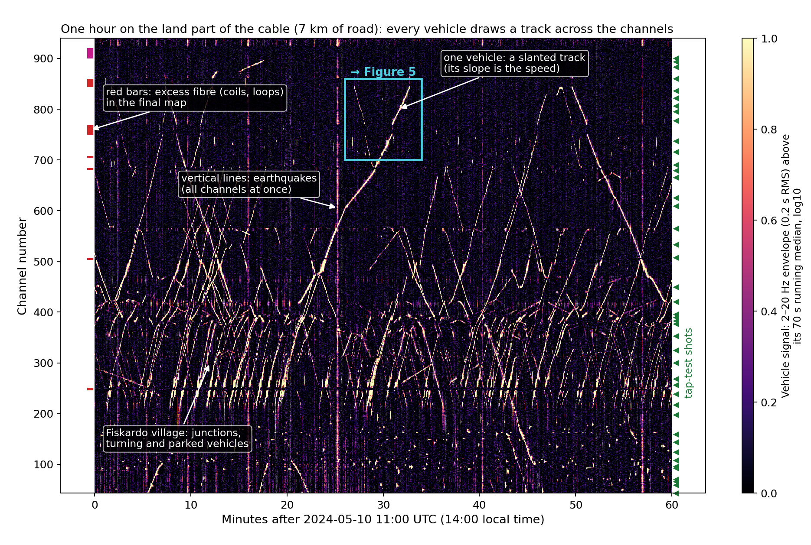

# das-channel-mapping-skill

**English** · [中文](README_zh.md)

**A Claude Code skill that finds the excess fibre along a DAS cable (the coils and loops of spare fibre) and takes
it out of the channel map.**

A DAS (distributed acoustic sensing) interrogator counts its channels along the fibre. The fibre is longer than
the route it follows, because installers store spare fibre in coils inside manholes and leave loops at splices
and road crossings. This skill locates that excess length with three signals:

| Signal | What it tells | What to look for |
|---|---|---|
| **Tap test**: hammer blows at GPS points | how much fibre is in excess, and between which two shots | more fibre between the two shot channels than road between the two GPS points |
| **Earthquakes** | which channels hold the excess | the amplitude drops on a run of channels, in every earthquake |
| **Passing vehicles** | whether those channels are at one point, and where on the road | every vehicle track jumps across them |

It then builds the channel map (latitude, longitude and a position uncertainty for every channel) with each coil
at its one point on the ground and its channels marked, so that they can be left out.


**Figure 1.** Schematic, drawn with the numbers of a real coil. **(a)** A cable under a road with a 3-channel
loop and a 19-channel coil, three tap-test shots A–C, a vehicle and an earthquake; below it, the same channels in
the order the interrogator counts them. **(b)** Synthetic earthquake record, one trace per channel.
**(c)** Synthetic vehicle tracks, channel against time. The 172 m of road between B and C hold 327 m of fibre; the
earthquake is about 20 times weaker on the loop and coil channels; each vehicle passes all 19 coil channels at
the same moment. Excess fibre shows as more fibre than road, an amplitude drop, and a jump in the vehicle tracks.

## 1. Why the excess fibre has to come out

### Channel number is not position

Channel *n* is *n* × the channel spacing along the **fibre**. Seismology needs its place on the **ground**. The
two agree only where the fibre follows its route metre for metre. Where spare fibre is stored, many channels are
at one point, and every channel behind that point is further along the fibre than along the route.

On the cable this skill was built on (Kefalonia–Ithaca, Greece: 15 km of land–sea–land cable, 1872 channels of
8.17 m), the fibre from the interrogator to the beach manhole is 7.32 km long. The ground under it is 6.44 km.
Of the 0.87 km difference, 0.71 km is stored at eight points: a reel next to the interrogator (134 m), six coils
and loops along the road (16 to 155 m each) and a coil in the beach manhole (172 m). The rest is spread along the
road.

### What goes wrong if it stays in the map

Figure 2 compares the true positions with the two usual ways of making a channel map.

- **Positions are wrong.** *Map 1* takes channel number × spacing as distance along the route. Each coil then
  shifts every channel behind it by its own length, and the shifts add up: 0.87 km at the Kefalonia beach.
  *Map 2* uses the tap-test shots as anchors and spreads the channels evenly between two shots. The error then
  stays between the two shots, but one 155 m coil still puts channels up to 56 m from where they are.
- **Signals jump in space.** All channels of a coil record the same ground motion at the same time. Laid out along
  the route, they turn every moveout into a flat step: an arrival seems to cross 155 m in no time, and everything
  behind the step is out of place (Figure 2c). A wavefield that is continuous on the ground is no longer
  continuous on the map.
- **Amplitudes are wrong.** Coiled fibre does not follow the ground. Its channels record earthquakes 10 to 20
  times weaker than their neighbours (Figure 3), which looks like a strong site effect and gives poor picks.



**Figure 2.** Schematic, same loop and coil as Figure 1. **(a)** Position along the road of each channel: true
(black), map 1 and map 2. **(b)** Position error of the two maps; right axis: the arrival-time error it causes
for a wave travelling along the cable at 1 km/s. **(c)** Synthetic P and S arrivals (apparent velocity 3 and
1.2 km/s) with every channel placed by map 1. **(d)** The same arrivals with the loop and the coil at their
points. Map 1 is 180 m off behind the coil and map 2 up to 47 m off between the shots; in (c) the 19 coil picks
form a flat step 155 m wide and the picks behind it come 60 ms (P) and 150 ms (S) early. Excess fibre left in
the map breaks the continuity of the arrivals in space; putting it at its points restores it.

### Picks and association

Phase pickers give one arrival time per channel. An associator such as GaMMA (Zhu et al., 2022) then treats every
channel as a station at its mapped coordinates, and looks for origins that predict the picked times and,
optionally, the amplitudes. With excess fibre left in the map it gets:

- the picks of a coil: one arrival time, but *N* different coordinates;
- every pick behind the coil at a wrong coordinate. The time error is the position error divided by the apparent
  velocity along the cable:

  | Real numbers from the cable above | Position error | Time error at 5 km/s | at 1 km/s |
  |---|---|---|---|
  | Map 2: one 155 m coil between two shots | up to 56 m | 0.01 s | 0.06 s |
  | Map 1: all excess fibre left in, at the beach | 0.87 km | 0.17 s | 0.87 s |

- an error with the same sign on every channel behind the coil. It is a bias, so it does not average out over
  channels the way pick noise does. It moves the location, or it pushes picks outside the time tolerance so that
  they are not associated;
- amplitudes 10 to 20 times too low on the coil channels.

Waves that arrive steeply have a high apparent velocity and a small time error. Slow waves along the cable (S and
surface waves in soft ground, vehicles) have the largest. The same holds for anything else that uses distance
along the cable: apparent velocities, f–k filtering, beamforming, surface-wave dispersion, vehicle tracking.

## 2. How it works

### Tap test: how much excess fibre, and between which shots

A hammer blow at a GPS point is strongest on the channel under it, so that channel becomes an anchor. For each
pair of neighbouring shots the skill compares the fibre between their channels with the road between their GPS
points (OpenStreetMap roads or the operator's route). A few metres of difference is measurement error. Tens of
metres is excess fibre.

Kefalonia: 45 shots, 42 road segments. In 37 of them fibre and road agree within −10 to +22 m. Five hold 36, 42,
44, 146 and 149 m more fibre than road. The tap test says how much and between which shots, but not where in
between. Two small cases show in the blows themselves: a loop next to a shot gives a second peak a few channels
away, and a coil at the shot point responds on all its channels at once.

### Earthquakes: which channels (the amplitude drop)

A regional earthquake shakes a few kilometres of cable almost evenly. Fibre that follows the ground records it.
Fibre coiled in a manhole hardly does. The skill takes 5 to 10 earthquakes from two or three directions, measures
the signal on each channel, and looks for runs of channels that are much weaker than their neighbours (below
0.2 ×) while their noise is normal.


**Figure 3.** Kefalonia land part, channels 700–935 (1.9 km of fibre). **(a, b)** Two earthquakes from different
directions: amplitude against channel and time. **(c, d)** Strain rate of each channel across one coil, all traces
at the same gain. **(e)** Signal amplitude of eight earthquakes (ML 2.8–4.1, 9–38 km away, three directions)
relative to the channels on the road. Three runs of channels stay dark in both earthquakes, their traces are far
weaker than those next to them, and all eight earthquakes drop to 0.06–0.10 × on the same channels. These runs
are fibre that does not follow the ground: the candidates for coils.

Kefalonia: each of the five segments with excess fibre holds exactly one weak run, about as long as the excess
(41, 33, 25, 155 and 131 m of fibre). The other 37 segments hold none. The chance of five runs landing in those
five segments by accident is about 2 × 10⁻⁴. The drop is the same for every earthquake and direction, its edges
are one or two channels wide and the noise stays normal, which rules out source direction, site effects and
instrument problems.

### Vehicles: at one point or not, and where (the jump)

A weak run is fibre that does not follow the ground. It can be a coil at one point, or loose fibre lying along a
stretch. Vehicles tell the two apart. On a road, a vehicle reaches one channel after another at its speed and
draws a slanted track (Figure 4). If *N* channels are at one point, they all respond at the same moment and the
track jumps over them (Figure 5).



**Figure 4.** Kefalonia land part, channels 43–940, one hour of 2024-05-10: vehicle signal (2–20 Hz envelope above
its running median) against time and channel. Every vehicle draws a slanted track whose slope is its speed; the
tracks are broken at the red bars. The traffic that is already in the recording crosses the coils several times
an hour.


**Figure 5.** Zoom on the box of Figure 4. **(a)** Two vehicles crossing three coils (red bands). **(b)** Vehicle
signal of channels 738–780 as the second vehicle passes. **(c)** Its arrival time at each channel. Before the coil
the vehicle needs 1.7 s per channel (4.8 m/s). The 19 coil channels rise together, and channel 769 follows
channel 749 after 2.3 s; along the road those channels would take 34 s. The coil is at one point of the road, and
the moment of the jump says where.

The skill measures the jump on many hours of traffic (cross-correlations between channels, stacked) and on single
tracked vehicles: the number of road channels a vehicle needs to cross the run is near 0 for a coil and near *N*
for a stretch along the road. Kefalonia, 60 days: 0.9 to 1.4 channels for the five runs, 3 to 24 for control
stretches of the same lengths. The moment a coil responds also gives its place on the road, within about ±4 m on
a straight road. The vehicles also found a 3-channel coil that was too small for the earthquakes, and showed
that 17 weak channels on the far shore are not a coil but fibre laid along a detour.

### Into the map

Each block of excess fibre goes to its one point. The other channels of the segment are spread evenly along the
road. The submarine part is stretched between the two waterlines, where the ocean-wave signal stops. Every
channel gets a position uncertainty `pos_unc_m`, and the column `slack` marks the channels of a block.


**Figure 6.** The Kefalonia–Ithaca map rebuilt from its real inputs by the demo below. **(a)** All 1872 channels.
**(b)** Kefalonia land: 43 tap-test anchors and the blocks of excess fibre (circles), each at one point of the
road. **(c)** Fibre minus ground, summed along the cable. **(d)** Position uncertainty per channel. The curve in
(c) rises in steps, one per block, to 0.87 km at the beach.

The Kefalonia–Ithaca map holds seven blocks (16 to 172 m of fibre). AIS positions of 43 large ships crossing the
submarine part, which were not used to build the map, give an along-cable offset of −7 m (90 % range −146 to
+26 m). With the map used before, which had no coils and a wrong distance convention, it was −279 m.

## 3. How to use it

**Install** the skill once. Claude Code finds it by itself:

```bash
git clone https://github.com/WANGYuhan2002/das-channel-mapping-skill
pip install -r das-channel-mapping-skill/requirements.txt
mkdir -p ~/.claude/skills
ln -s "$PWD/das-channel-mapping-skill/das-channel-mapping" ~/.claude/skills/das-channel-mapping
```

**Ask Claude** in plain words, in English or Chinese, or call `/das-channel-mapping`:

- "Map the DAS channels of my cable from this tap-test log and the operator's route"
- "Is there a fibre coil between shots 14 and 15?"
- "Which channels are in coils and should be left out before association?"
- "用这份锤击记录做通道映射" · "这两个锤点之间有没有盘缆"

Claude works through [`SKILL.md`](das-channel-mapping/SKILL.md) step by step. It asks for the inputs it needs, runs
the scripts, shows a figure at each step, and asks you before every judgement call (windows, thresholds, moving an
anchor, writing a coil into the map).

**Use the map.** Leave out the marked channels before picking and association:

```python
import pandas as pd
m = pd.read_csv("examples/kefalonia/out/channel_map_8m.csv")   # written by the demo below
# leave out the excess fibre and the fibre inside and next to the interrogator
keep = m[m.slack.isna() & ~m.segment.isin(["internal", "cabin"])]
stations = keep[["raw_col", "lat", "lon", "pos_unc_m"]]         # 1758 of 1872 channels, one station each
```

**Try it without Claude.** The demo rebuilds the Kefalonia–Ithaca map from its real inputs (45 tap-test shots with
GPS, OpenStreetMap roads, the operator's routes, the coil positions found as above) and draws Figure 6:

```bash
git clone https://github.com/WANGYuhan2002/das-channel-mapping-skill && cd das-channel-mapping-skill
pip install -r requirements.txt
python3 examples/kefalonia/run_kefalonia.py
```

The rebuilt map matches the delivered one to 0.76 m. Inputs and their sources are listed in
[`examples/kefalonia/README.md`](examples/kefalonia/README.md), the evidence behind every block in
[`references/kefalonia-example.md`](das-channel-mapping/references/kefalonia-example.md). A second demo,
`python3 examples/synthetic/run_demo.py`, maps a synthetic cable with a known truth
([`docs/demo.png`](docs/demo.png)): a 41 m coil spread evenly puts channels up to 17 m off, and 3.8 m with the
coil at its point.

**What you need**

| Input | Needed for |
|---|---|
| Channel count, channel spacing (with the fibre-length multiplier), header start distance, gauge length | always |
| A tap test with a GPS point per shot, and/or storm and calm wave power near the shore | any absolute position |
| A route: OpenStreetMap roads, the operator's drawing, or one drawn by hand | between anchors |
| 5–10 regional earthquakes and some hours of traffic | finding the excess fibre |
| AIS ship tracks | optional check of the submarine part |

The scripts start from derived arrays (envelopes, band powers, earthquake windows, vehicle tracks; each script's
`--help` gives the formats). Reading your interrogator's files and tracking vehicles are not included.

**Limits**

- Accuracy comes from the anchors. Between them, positions are interpolated. The `pos_unc_m` rules (5–15 m on
  roads, 30 m at sea, 60 m on an end with no anchor) are rules of thumb from one cable, not a fitted error model.
- Only excess fibre that earthquakes or vehicles can see gets located. The rest stays spread over its segment.
  Where the edges of a block go is a judgement call.
- Vehicles place coils, not ordinary channels: they brake at corners, which moves positions by 10–30 m.
- There are no anchors at sea. The submarine part is only stretched between the waterlines.
- It is not one-click. Windows, thresholds and which weak run is a coil are human decisions.
- Tested on one real cable and on synthetic data. Aerial, borehole or duct cables with frequent slack loops are
  untested.

<details>
<summary><b>Scripts</b> (in <code>das-channel-mapping/scripts/</code>, each with <code>--help</code>)</summary>

| Script | Does |
|---|---|
| `hammer_anchor.py` | finds and stacks the blows of each shot; anchor channel, footprint, loops, coils; which distance convention a log used |
| `waterline_waves.py` | waterline and end of a beach from storm and calm wave power |
| `road_path.py` | OpenStreetMap paths between anchors, shifted through the shot points; checked against a reference route |
| `build_channel_map.py` | the channel map from a JSON config of pieces (point, line, path, anchored, ratio) |
| `quake_coupling.py` | weakly coupled runs from regional earthquakes, matched with each segment's excess fibre |
| `vehicle_coil.py` | coil at one point or a stretch along the road, and the coil's point on the road |
| `validate_map.py` | checks: GPS against the route, AIS crossings, hammer travel times |
| `make_delivery.py` | data dictionary, slack inventory, change table, GeoJSON / KML, md5 manifest |
| `upload_version.sh` | uploads a delivery as a new version, checks the md5 on the remote, moves `current` |

Tests: `python3 -m pytest -q tests/`. They run every script and the synthetic demo, and check that the
Kefalonia–Ithaca demo rebuilds the delivered map to within 1 m. Figures 1 and 2 are made by
`python3 docs/make_schematics.py`. Figures 3 to 5 come from the Kefalonia recordings, which are not in this
repository.

</details>

## Reference, credits and license

Zhu, W., McBrearty, I. W., Mousavi, S. M., Ellsworth, W. L., & Beroza, G. C. (2022). Earthquake phase association
using a Bayesian Gaussian mixture model. *Journal of Geophysical Research: Solid Earth, 127*, e2021JB023249.

OpenStreetMap data © OpenStreetMap contributors (ODbL); credit it on figures made with OSM paths. The coastline in
Figure 6 is from the Copernicus GLO-30 DEM (© DLR e.V. 2010–2014 and © Airbus Defence and Space GmbH 2014–2018
provided under COPERNICUS by the European Union and ESA; all rights reserved). Code: MIT license, see
[LICENSE](LICENSE); the terms of the example data are in
[`examples/kefalonia/README.md`](examples/kefalonia/README.md).
