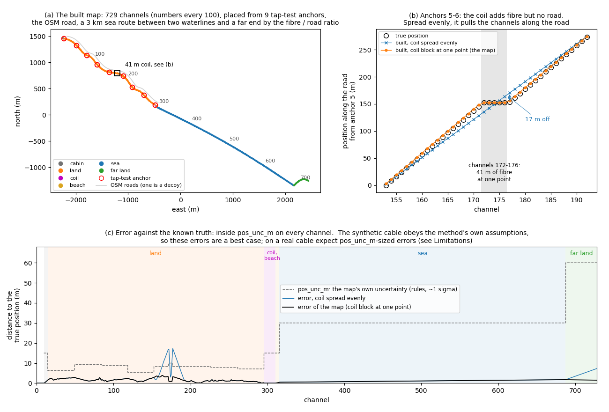

# das-channel-mapping

**English** · [中文](README_zh.md)

Put every channel of a DAS (distributed acoustic sensing) fibre on the map: latitude, longitude and a position
uncertainty, for land, submarine or mixed cables. It is a Claude Code skill plus plain Python scripts that also
run on their own.



## Demo (one minute)

```bash
git clone https://github.com/WANGYuhan2002/das-channel-mapping && cd das-channel-mapping
pip install -r requirements.txt
python3 examples/synthetic/run_demo.py
```

The demo makes a synthetic 729-channel cable with a known truth. It has a winding road with 9 tap-test anchors
and a 41 m coil, a manhole coil, a 3 km sea route and a far shore with no anchors. The demo maps the cable,
checks every channel against the truth and draws the figure above. It prints:

```
          channels  error_median_m  error_max_m  pos_unc_median_m inside_pos_unc
cabin            5             0.7          1.4              15.0           100%
land           281             1.4          3.8               8.3           100%
coil            15             0.0          0.0              15.0           100%
beach            5             0.2          0.3              15.0           100%
sea            372             1.1          1.7              30.0           100%
far_land        41             1.6          1.7              60.0           100%

Segment with the 41 m coil (anchors 5-6, channels 153-192): max error 17 m if the coil is spread evenly,
3.8 m with the coil block (channels 172-176 at one point).
```

These errors are a best case. The synthetic cable follows the method's own assumptions, so on a real cable
expect errors about the size of `pos_unc_m`.

## How a map is built

1. **Anchors.** Channels the data tie to a point on the ground: tap-test (hammer) shots with GPS, and the
   waterlines where ocean-wave noise stops.
2. **Paths** between anchors. OpenStreetMap roads shifted through the shot points, the operator's route, or a
   route you draw.
3. **Placement.**
   - Channels are uniform in channel number between anchors.
   - A slack coil sits at one point.
   - The sea route is stretched between the two waterlines.
   - An end with no anchor is laid out with the fibre/road ratio measured on the anchored part.
4. **Slack.** Segments with extra fibre are candidates. Earthquakes show where the fibre does not follow the
   ground; passing cars show whether that fibre is coiled at one point and where.
5. **Uncertainty, checks, delivery.**
   - Each channel gets a `pos_unc_m` from simple rules.
   - The map is checked against data that did not build it: shot GPS, AIS ship crossings, hammer travel times.
   - It is delivered as a versioned package: tables, data dictionary, change table, GeoJSON / KML, md5.

## What you need

| Input | Needed for |
|---|---|
| Channel count, spacing (with the fibre-length multiplier), header start distance, gauge length | always |
| A tap test with a GPS point per shot, and/or storm vs calm wave power near the shore | any absolute position |
| A route: OSM roads, the operator's drawing, or one drawn by hand | between anchors |
| 5–10 regional earthquakes; some hours of traffic; AIS ship tracks | optional: slack, checks |

The scripts start from derived arrays: envelopes, band powers, earthquake windows and car tracks. Each script's
`--help` gives the formats. Reading your interrogator's files and tracking cars are **not** included.

## Use it with Claude Code

From the repository folder:

```bash
ln -s "$PWD/das-channel-mapping" ~/.claude/skills/das-channel-mapping
```

Then ask, in English or Chinese, for example "map the DAS channels from this tap-test log", "is there a fibre
coil between shots 14 and 15?" or "where is channel 750?". The skill walks through the steps in
[`SKILL.md`](das-channel-mapping/SKILL.md) and asks you for the judgement calls: windows, thresholds, and
whether a block goes into the map.

## Strengths

- **Traceable.** Every channel has a position and an uncertainty, and its row says what placed it: the segment,
  the path source and any slack block.
- **Little fieldwork.** Only one tap test. Everything else is already in the recording (ocean waves,
  earthquakes, traffic) or public (OSM roads).
- **It handles slack coils**, which are the largest single error on land. On the real cable, one 155 m coil
  spread evenly put channels up to 56 m off; the demo shows the same effect.
- **Independent checks.** GPS, AIS and hammer travel times are data that did not go into the build.
- **Proven on a real 15 km land–sea–land cable** (Kefalonia–Ithaca, Greece, 2024):
  - the bias of AIS ship crossings went from −279 m with the old map to −7 m;
  - earthquakes found one weak run in each of the 5 segments with more than 30 m of extra fibre, and none in
    the other 37.

  Details are in [`references/kefalonia-example.md`](das-channel-mapping/references/kefalonia-example.md).

## Limitations

- **Accuracy comes from anchors.** Between them, positions are interpolated. The `pos_unc_m` rules (5–15 m on
  roads, 30 m at sea, 60 m on an end with no anchor) are rules of thumb from one cable, not a fitted error model.
- **There are no anchors at sea.** The submarine part is only stretched between the waterlines. AIS checks just
  its overall along-cable offset where big ships cross. On Kefalonia–Ithaca the median was −7 m, with a 90 %
  confidence interval of −146 to +26 m.
- **The path is assumed.** If the cable leaves the road between two anchors, only a gross mismatch shows up
  (fibre clearly shorter than the path).
- **Some slack goes unfound.** Only slack that earthquakes or traffic can see gets located; anything else stays
  spread over its segment. Where a block's edges go is a judgement call.
- **Cars place coils, not ordinary channels.** Cars brake at corners, which moves positions by 10–30 m.
- **Not one-click.** Picks such as windows, thresholds and which weak run is a coil are human decisions.
- **Tested on one real cable** and on synthetic data. Buried, aerial, borehole or duct cables with frequent
  slack loops are untested.

## Scripts

Everything is in `das-channel-mapping/scripts/`, and every script has `--help`.

| Script | Does |
|---|---|
| `hammer_anchor.py` | finds and stacks the blows of each shot; anchor channel, footprint, loops, coils; which distance convention a log used |
| `waterline_waves.py` | waterline and end of a beach from storm vs calm wave power |
| `road_path.py` | OSM paths between anchors, shifted through the shot points; checked against a reference route |
| `build_channel_map.py` | the channel map from a JSON config of pieces (point, line, path, anchored, ratio) |
| `quake_coupling.py` | weakly coupled runs from regional earthquakes, matched with each segment's extra fibre |
| `vehicle_coil.py` | coil at one point or a stretch along the road, and the coil's point on the road |
| `validate_map.py` | checks: GPS vs route, AIS crossings, hammer travel times |
| `make_delivery.py` | data dictionary, slack inventory, change table, GeoJSON / KML, md5 manifest |
| `upload_version.sh` | uploads a delivery as a new version, checks the md5 on the remote, moves `current` |

Tests: `python3 -m pytest -q tests/`. They run every script and the demo on synthetic data. The scripts were also
checked against the original Kefalonia–Ithaca results. No data and no coordinates of that cable are in this
repository.

## Credits and license

OpenStreetMap data © OpenStreetMap contributors (ODbL); credit it on figures made with OSM paths. MIT license, see
[LICENSE](LICENSE).
