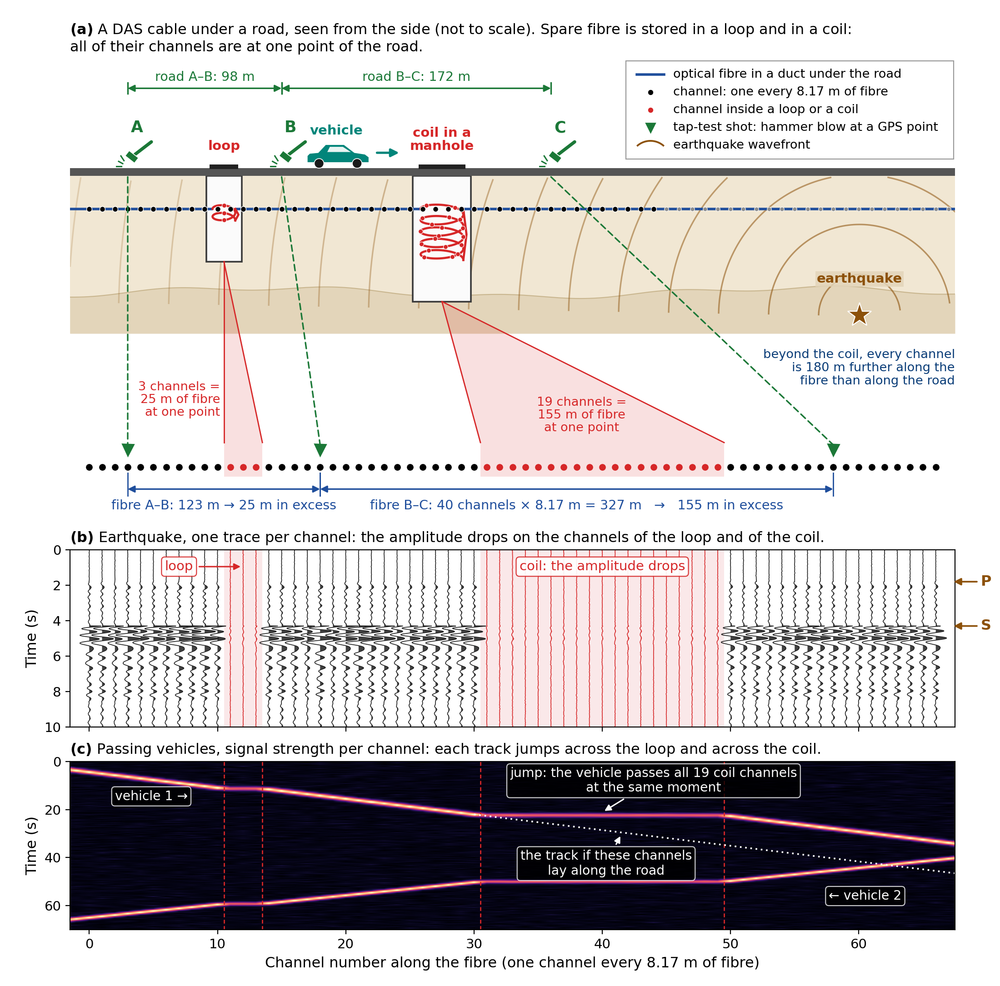
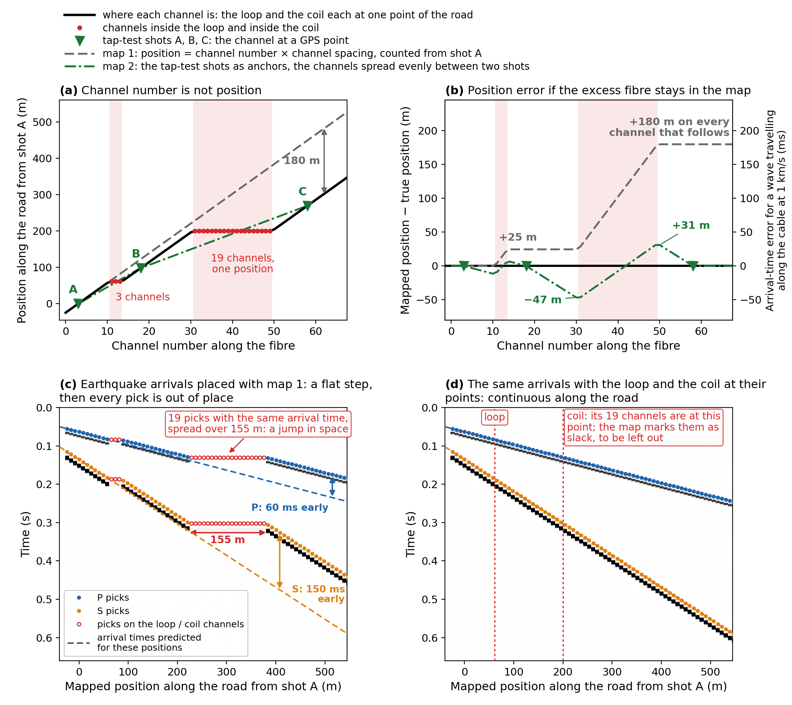
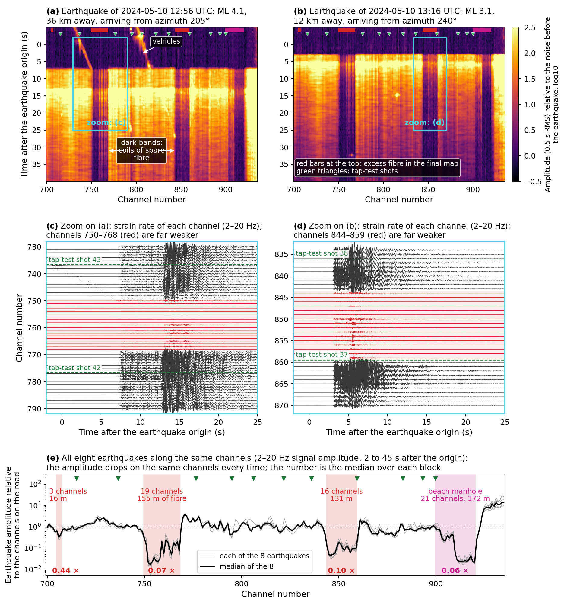
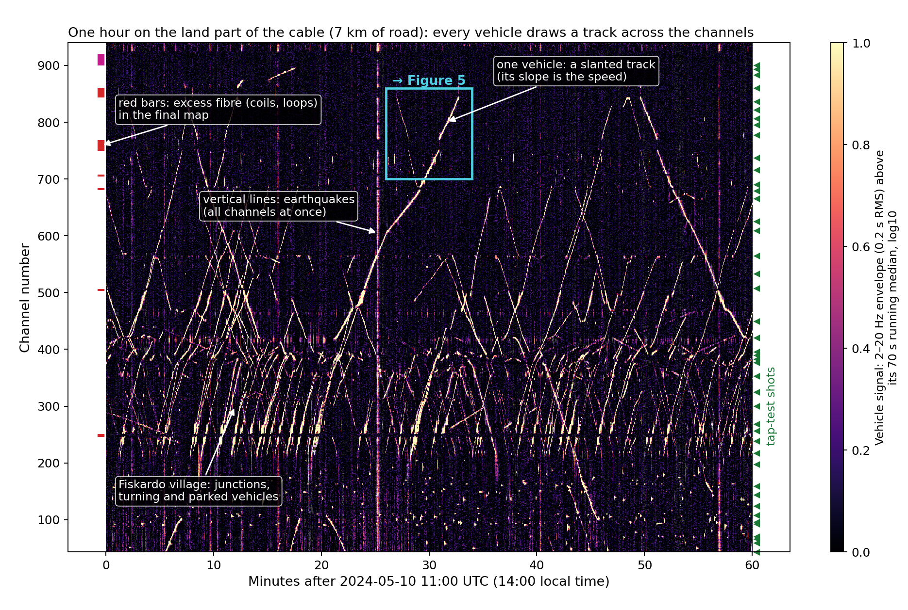
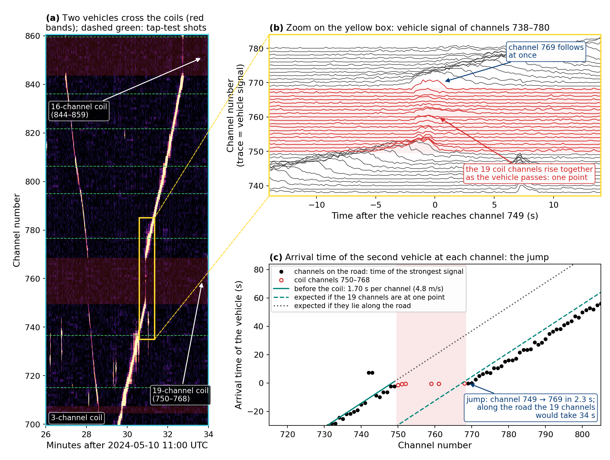
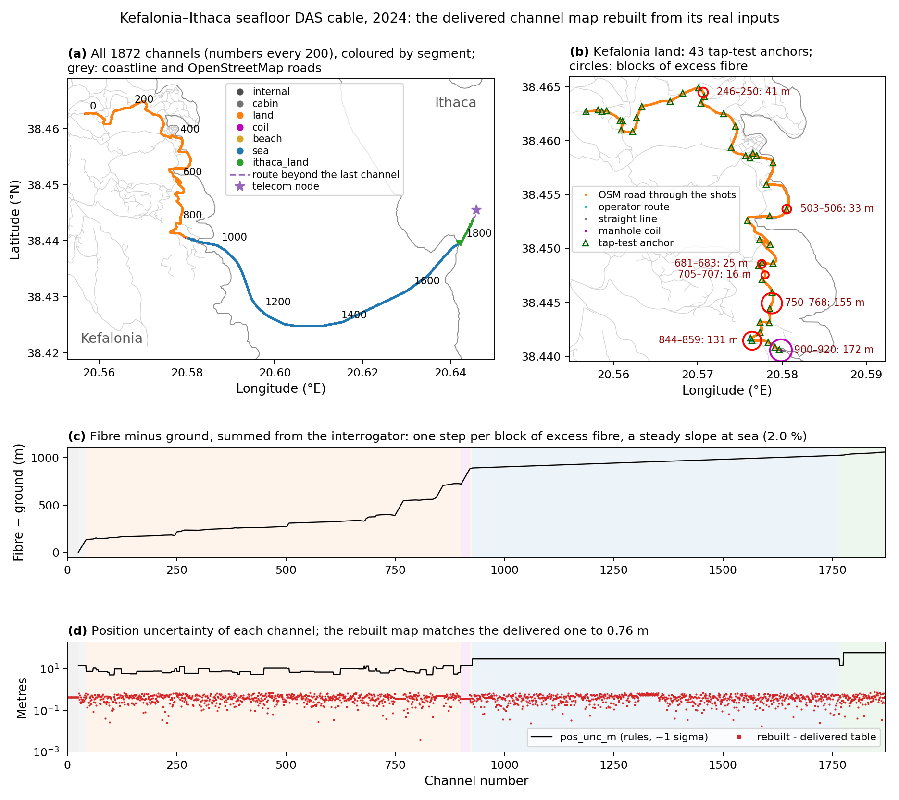

# das-channel-mapping-skill

[English](README.md) · **中文**

**这是一个 Claude Code skill：找出 DAS 光缆沿线多余的光纤（盘缆和回环，下文统称余缆），并把它们从通道表里去掉。**

DAS（分布式光纤声波传感）解调仪是沿着光纤数道的，而光纤比它走的路由要长：施工时会把富余的光纤盘在人井里，在接头和过路的地方留下回环。这个 skill 用三种信号把这些多出来的长度找出来：

| 信号 | 回答什么问题 | 看什么 |
|---|---|---|
| **锤击试验**：在有 GPS 的点上敲击 | 多出多少光纤，在哪两个锤点之间 | 两个锤点对应的道之间，光纤比两个 GPS 点之间的路长 |
| **地震** | 多出来的光纤是哪几道 | 每次地震里，都是这一段道的幅度下降 |
| **过路车辆** | 这几道是不是在同一点，在路上哪里 | 每条车辆轨迹在这几道上发生跳变 |

然后建通道表：每一道都有经纬度和位置不确定度，每圈盘缆放在地面上它所在的那一点，并在表里标出这些道，使用时可以直接去掉。



**图 1.** 示意图，用的是一圈真实盘缆的数字。**(a)** 公路下的光缆，带一个 3 道的回环和一圈 19 道的盘缆，三个锤击点 A–C，一辆车，一次地震；下面是同样这些道，按解调仪的计数顺序排开。**(b)** 合成的地震记录，每道一条波形。**(c)** 合成的车辆轨迹，横轴是道号，纵轴是时间。B、C 之间的路长 172 m，却有 327 m 光纤；回环和盘缆那几道上的地震信号弱了约 20 倍；每辆车在同一时刻经过盘缆的全部 19 道。余缆的三个表现就是：光纤比路长、地震幅度下降、车辆轨迹跳变。

## 1. 为什么必须去掉余缆

### 道号不等于位置

第 *n* 道的含义是沿**光纤** *n* × 道距。地震学需要的是它在**地面**上的位置。只有光纤一米不差地贴着路由走，这两者才一致。存放余缆的地方，很多道其实在同一点；这一点之后的每一道，沿光纤的距离都比沿路由的距离多出这一段。

这个 skill 是在希腊 Kefalonia–Ithaca 光缆上做出来的（15 km，陆–海–陆，1872 道，道距 8.17 m）。从解调仪到海滩人井，光纤长 7.32 km，而它下面的地面只有 6.44 km。相差的 0.87 km 里，有 0.71 km 集中存放在八个点上：解调仪旁的一盘（134 m）、沿路六处盘缆和回环（每处 16 到 155 m）、海滩人井里的一圈（172 m）。其余的分散在整条路上。

### 留在通道表里会怎样

图 2 把真实位置和两种常见的通道表做法放在一起比较。

- **位置错。** *做法 1* 把“道号 × 道距”当作沿路由的距离。每圈盘缆会把它后面所有的道都推远一个盘缆长度，而且一路累加：到 Kefalonia 海滩时已错 0.87 km。*做法 2* 用锤击点作锚点，两个锤点之间按道号均匀摊开。误差被限制在两个锤点之间，但一圈 155 m 的盘缆仍会让道偏离真实位置最多 56 m。
- **信号在空间上跳变。** 一圈盘缆的所有道在同一时刻记录同一处的地面运动。把它们沿路由摊开，每条时距曲线上都会出现一段平台：到时好像瞬间跨过了 155 m，平台之后的一切都错位（图 2c）。在地面上本来连续的波场，放到通道表上就不连续了。
- **幅度错。** 盘起来的光纤不随地面运动，这些道记录到的地震比相邻道弱 10 到 20 倍（图 3），看上去像很强的场地效应，拾取质量也差。



**图 2.** 示意图，回环和盘缆同图 1。**(a)** 每道沿路的位置：真实位置（黑）、做法 1、做法 2。**(b)** 两种做法的位置误差；右轴是它对一个沿缆以 1 km/s 传播的波造成的到时误差。**(c)** 合成的 P、S 到时（沿缆视速度 3 和 1.2 km/s），每道按做法 1 放置。**(d)** 同样的到时，回环和盘缆各放在自己的点上。做法 1 在盘缆之后错 180 m，做法 2 在锤点之间最多错 47 m；(c) 中盘缆的 19 个拾取排成 155 m 宽的平台，其后的拾取比预测早 60 ms（P）和 150 ms（S）。余缆留在表里会破坏到时在空间上的连续性，放回它所在的点就恢复了。

### 拾取与关联

震相拾取给每一道一个到时。GaMMA（Zhu et al., 2022）这类关联算法随后把每一道当作一个台站，坐标取自通道表，去找能同时预测这些到时（也可以加上幅度）的震源。如果余缆还在表里，它拿到的是：

- 盘缆上的拾取：同一个到时，却有 *N* 个不同的坐标；
- 盘缆之后的每个拾取都放在错误的坐标上。到时误差 = 位置误差 ÷ 沿缆视速度：

  | 上面这条光缆的真实数字 | 位置误差 | 视速度 5 km/s 时 | 1 km/s 时 |
  |---|---|---|---|
  | 做法 2：两个锤点之间一圈 155 m 的盘缆 | 最多 56 m | 0.01 s | 0.06 s |
  | 做法 1：余缆全部留在表里，在海滩处 | 0.87 km | 0.17 s | 0.87 s |

- 这个误差在盘缆之后的每一道上符号相同。它是系统偏差，不像拾取噪声那样能靠很多道平均掉。它要么把定位带偏，要么让拾取超出时间容差而关联不上；
- 盘缆那几道的幅度低 10 到 20 倍。

入射很陡的波视速度高，到时误差小；沿缆传播的慢波（软土里的 S 波和面波、车辆）误差最大。凡是用到沿缆距离的处理都一样受影响：视速度、f–k 滤波、聚束、面波频散、车辆跟踪。

## 2. 工作原理

### 锤击：多出多少光纤，在哪两个锤点之间

在一个 GPS 点上敲击，正下方那一道响应最强，这一道就成为锚点。对每一对相邻锤点，skill 比较两个锚点道之间的光纤长度和两个 GPS 点之间的路长（OpenStreetMap 道路或运营商路由）。差几米是测量误差，差几十米就是余缆。

Kefalonia：45 个锤点，42 段路。其中 37 段光纤和路长相差在 −10 到 +22 m 之内，另外 5 段光纤比路多 36、42、44、146 和 149 m。锤击能说出多了多少、在哪两个锤点之间，但说不出在这一段里的哪儿。有两种小情况锤击本身就能看到：锤点旁边的回环会在隔几道的地方多出一个峰；盘在锤点处的盘缆，所有道同时响应。

### 地震：是哪几道（幅度下降）

一次区域地震对几公里光缆的摇动几乎是均匀的。贴着地面的光纤能记录到，盘在人井里的光纤几乎记录不到。skill 取 5 到 10 个来自两三个方向的地震，量每一道的信号，找出比相邻道弱得多（低于 0.2 倍）而噪声正常的连续道段。



**图 3.** Kefalonia 陆上段，700–935 道（1.9 km 光纤）。**(a, b)** 两次不同方向的地震：幅度随道号和时间的变化。**(c, d)** 跨过一圈盘缆的各道应变率，所有波形用同一增益。**(e)** 八次地震（ML 2.8–4.1，震中距 9–38 km，三个方向）的信号幅度，相对于路上的道。有三段道在两次地震里都是暗的，波形比两侧弱得多；八次地震在同样这几段道上都降到 0.06–0.10 倍。这几段是不随地面运动的光纤，也就是盘缆的候选。

Kefalonia：光纤多出来的那 5 段，每段里恰好各有一段弱耦合道，长度和多出的光纤大致相当（41、33、25、155、131 m 光纤）；其余 37 段一段也没有。五段弱道碰巧都落在这五段里的概率约 2 × 10⁻⁴。每次地震、每个方向的下降都一样，边界只有一两道宽，噪声保持正常，这就排除了震源方向、场地效应和仪器问题。

### 车辆：是不是在一点，在哪儿（跳变）

弱耦合道段是不随地面运动的光纤，它可能是盘在一点的盘缆，也可能是松散地沿一段路放着。车辆能把这两种情况分开。在路上，车按自己的速度一道接一道地经过，画出一条斜线（图 4）。如果 *N* 道在同一点，它们会同时响应，轨迹就从这几道上跳过去（图 5）。



**图 4.** Kefalonia 陆上段，43–940 道，2024-05-10 的一个小时：车辆信号（2–20 Hz 包络高出其滑动中位数的部分）随时间和道号的变化。每辆车画出一条斜线，斜率就是车速；轨迹在红色短杠处断开。记录里本来就有的车流，每小时会经过这些盘缆好几次。



**图 5.** 图 4 方框的放大。**(a)** 两辆车经过三处盘缆（红色条带）。**(b)** 第二辆车经过时 738–780 道的车辆信号。**(c)** 它到达每一道的时间。到盘缆之前，车每道用 1.7 s（4.8 m/s）。盘缆的 19 道一起抬升，769 道在 749 道之后 2.3 s 就响应；如果这些道沿路铺开，需要 34 s。所以这圈盘缆在路上的一个点，跳变发生的时刻给出它在哪儿。

skill 用很多小时的车流（道间互相关的叠加）和逐辆跟踪的单车来量这个跳变：车穿过这一段需要的“路上道数”，盘缆接近 0，沿路铺开的一段接近 *N*。Kefalonia 60 天：五段弱耦合道为 0.9 到 1.4 道，同样长度的对照路段为 3 到 24 道。盘缆响应的时刻还给出它在路上的位置，直路上约 ±4 m。车辆还找到了一圈只有 3 道、地震看不出来的小盘缆；也证明了对岸有 17 道弱耦合道不是盘缆，而是沿一段绕行铺设的光纤。

### 写进通道表

每一块余缆放在它所在的那一点；这一段里其余的道沿路均匀摊开；海底段在两条水线（海浪信号消失的地方）之间拉伸。每一道都有位置不确定度 `pos_unc_m`，`slack` 列标出属于余缆块的道。



**图 6.** 下面的 demo 用真实输入重建的 Kefalonia–Ithaca 通道表。**(a)** 全部 1872 道。**(b)** Kefalonia 陆上：43 个锤击锚点和各块余缆（圆圈），每块在路上的一个点。**(c)** 光纤长度减去地面长度，沿缆累加。**(d)** 每道的位置不确定度。(c) 中的曲线呈台阶状上升，每块余缆一个台阶，到海滩时达到 0.87 km。

Kefalonia–Ithaca 的通道表里共有七块余缆（16 到 172 m 光纤）。用没有参与建图的数据检验：43 艘大船经过海底段时的 AIS 位置给出的沿缆偏差是 −7 m（90 % 范围 −146 到 +26 m）；用以前那张既没有盘缆、距离约定也不对的通道表时是 −279 m。

## 3. 怎么用

**安装** skill（一次即可），Claude Code 会自己找到它：

```bash
git clone https://github.com/WANGYuhan2002/das-channel-mapping-skill
pip install -r das-channel-mapping-skill/requirements.txt
mkdir -p ~/.claude/skills
ln -s "$PWD/das-channel-mapping-skill/das-channel-mapping" ~/.claude/skills/das-channel-mapping
```

**直接跟 Claude 说**，中文英文都可以，也可以输入 `/das-channel-mapping`：

- “用这份锤击记录和运营商路由给我的光缆做通道映射”
- “#14 和 #15 之间有没有盘缆”
- “哪些道在盘缆里，做关联之前应该去掉”
- "Map the DAS channels from this tap-test log"

Claude 会按 [`SKILL.md`](das-channel-mapping/SKILL.md) 一步步做：先问它需要的输入，再跑脚本，每一步给你看图；需要判断的地方（窗口、阈值、要不要挪锚点、要不要把盘缆写进表）都会先问你。

**使用通道表。** 拾取和关联之前，把标出来的道去掉：

```python
import pandas as pd
m = pd.read_csv("examples/kefalonia/out/channel_map_8m.csv")   # 由下面的 demo 生成
# 去掉余缆，以及解调仪内部和旁边的光纤
keep = m[m.slack.isna() & ~m.segment.isin(["internal", "cabin"])]
stations = keep[["raw_col", "lat", "lon", "pos_unc_m"]]         # 1872 道里的 1758 道，每道一个台站
```

**不用 Claude 也能试。** demo 用真实输入（45 个带 GPS 的锤击点、OpenStreetMap 道路、运营商路由、按上面方法找到的盘缆位置）重建 Kefalonia–Ithaca 通道表，并画出图 6：

```bash
git clone https://github.com/WANGYuhan2002/das-channel-mapping-skill && cd das-channel-mapping-skill
pip install -r requirements.txt
python3 examples/kefalonia/run_kefalonia.py
```

重建的表和交付的表最多差 0.76 m。每个输入是什么、从哪来，见 [`examples/kefalonia/README.md`](examples/kefalonia/README.md)；每块余缆背后的证据见 [`references/kefalonia-example.md`](das-channel-mapping/references/kefalonia-example.md)。第二个 demo `python3 examples/synthetic/run_demo.py` 给一条已知真值的合成光缆做通道映射（图见 [`docs/demo.png`](docs/demo.png)）：一圈 41 m 的盘缆如果均匀摊开，道最多偏 17 m；放回它所在的点后是 3.8 m。

**需要什么**

| 输入 | 用途 |
|---|---|
| 道数、道距（含光纤长度系数）、文件头起始距离、标距 | 必需 |
| 每个锤点带 GPS 的锤击试验，和/或近岸的风暴与平静时的海浪功率 | 绝对位置 |
| 路由：OpenStreetMap 道路、运营商图纸或手画路线 | 锚点之间 |
| 5–10 个区域地震和几小时的车流 | 找余缆 |
| AIS 船迹 | 可选，检验海底段 |

脚本的输入是处理过的数组（包络、频带功率、地震窗口、车辆轨迹），格式见各脚本的 `--help`。读取你的解调仪文件和跟踪车辆这两步不包括在内。

**局限**

- 精度来自锚点，锚点之间的位置是插值的。`pos_unc_m` 的规则（道路 5–15 m、海里 30 m、无锚点一端 60 m）是从一条光缆总结的经验值，不是拟合出来的误差模型。
- 只有地震或车辆看得出的余缆才能定位，其余的仍按段均摊。余缆块的边界放在哪，要人来判断。
- 车辆只用来定盘缆，不用来定普通道：车在弯道减速，会让位置偏 10–30 m。
- 海里没有锚点，海底段只是在两条水线之间拉伸。
- 不是一键流程：窗口、阈值、哪段弱耦合道算盘缆，都要人来定。
- 只在一条真实光缆和合成数据上测过，架空、井下或余缆很多的管道光缆还没测过。

<details>
<summary><b>脚本</b>（都在 <code>das-channel-mapping/scripts/</code> 里，每个都有 <code>--help</code>）</summary>

| 脚本 | 做什么 |
|---|---|
| `hammer_anchor.py` | 找出并叠加每个锤点的锤击；锚点道、足迹、回环、盘缆；检验野外记录用的是哪种距离 |
| `waterline_waves.py` | 用风暴和平静时的海浪功率定水线和沙滩尽头 |
| `road_path.py` | 锚点之间沿 OpenStreetMap 道路走，横移到穿过锤点；和参考路由对比 |
| `build_channel_map.py` | 按 JSON 配置（point、line、path、anchored、ratio）建通道表 |
| `quake_coupling.py` | 用区域地震找弱耦合道段，并和每段多出的光纤对应 |
| `vehicle_coil.py` | 判断是盘在一点还是沿路一段，定盘缆在路上的点 |
| `validate_map.py` | 检验：GPS 对路由、AIS 过缆、锤击走时 |
| `make_delivery.py` | 数据字典、余缆清单、变化表、GeoJSON / KML、md5 清单 |
| `upload_version.sh` | 把交付包上传为新版本，在远端核对 md5，再改 `current` |

测试：`python3 -m pytest -q tests/`，跑每个脚本和合成 demo，并检查 Kefalonia–Ithaca demo 重建的表与交付的表相差不到 1 m。图 1、图 2 由 `python3 docs/make_schematics.py` 生成；图 3 到图 5 来自 Kefalonia 的原始记录，这些数据不在仓库里。

</details>

## 参考文献、致谢与许可

Zhu, W., McBrearty, I. W., Mousavi, S. M., Ellsworth, W. L., & Beroza, G. C. (2022). Earthquake phase association using a Bayesian Gaussian mixture model. *Journal of Geophysical Research: Solid Earth, 127*, e2021JB023249.

OpenStreetMap 数据 © OpenStreetMap contributors（ODbL），用 OSM 路径画的图要注明。图 6 里的海岸线来自 Copernicus GLO-30 DEM（© DLR e.V. 2010–2014 and © Airbus Defence and Space GmbH 2014–2018 provided under COPERNICUS by the European Union and ESA; all rights reserved）。
代码用 MIT 许可，见 [LICENSE](LICENSE)；示例数据的使用条件见 [`examples/kefalonia/README.md`](examples/kefalonia/README.md)。
